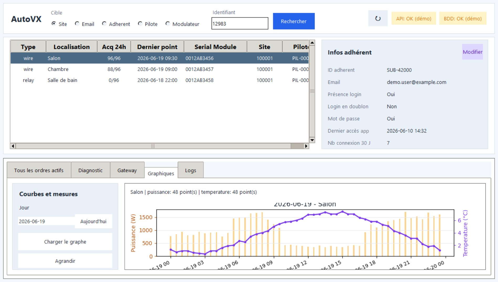

# IoT Support Diagnostic Tool

Internal diagnostic tool built for support and operations teams of a connected-home energy product. It gives real-time visibility into the full IoT command chain, from the user's intent in the mobile app down to each connected device.

This repository documents the scope and the approach. The source code is not published. The screenshot uses demo data.

## The problem

When a connected device did not respond to a user's command, support teams had no unified view of why. Diagnosing meant cross-referencing several internal systems by hand, which was slow and error-prone, and often ended in an escalation from first-level support to product and then to engineering.

## What it does

### Command chain tracing
For each device on a site, the tool shows the command pipeline end to end:

- the user's intent (weekly schedule, manual control, quick mode, absence detection) and the target setpoint (comfort, eco, frost protection, temperature, off);
- the order status at each layer: platform, 4G gateway, Zigbee module, device;
- a visual warning when the layers disagree, showing where the chain breaks.

### Configuration diagnostics
It surfaces configuration problems that were not visible in the CRM: account anomalies (missing or duplicated login), onboarding status, connection frequency, email history with delivery status, and the results of the self-service diagnostic run by the user in the app.

### Remote actions
A small set of pre-configured, scoped actions lets support restart or re-pair gateway and module equipment, locked so that dangerous operations cannot be triggered.

## Access
Lookup by site, member, pilot, modulator or email address, behind an internal login.

## Stack

- **Python**: backend, data queries, API calls
- **Internal APIs**: IoT platform and gateway communication layer
- **MySQL and BigQuery**: device state and configuration data
- **AI-assisted development (vibe coding)**: the ergonomic front-end

## Impact

- Used daily by 12 support and operations team members.
- Several diagnostics and corrective actions were only available through this tool.
- Removed the escalation chain (first-level support, product, engineering) for a large class of issues: agents diagnose and act during the call.
- Diagnostic time per case went from minutes to seconds.

## Author

Built autonomously by a product manager, as a product-and-engineering initiative.
